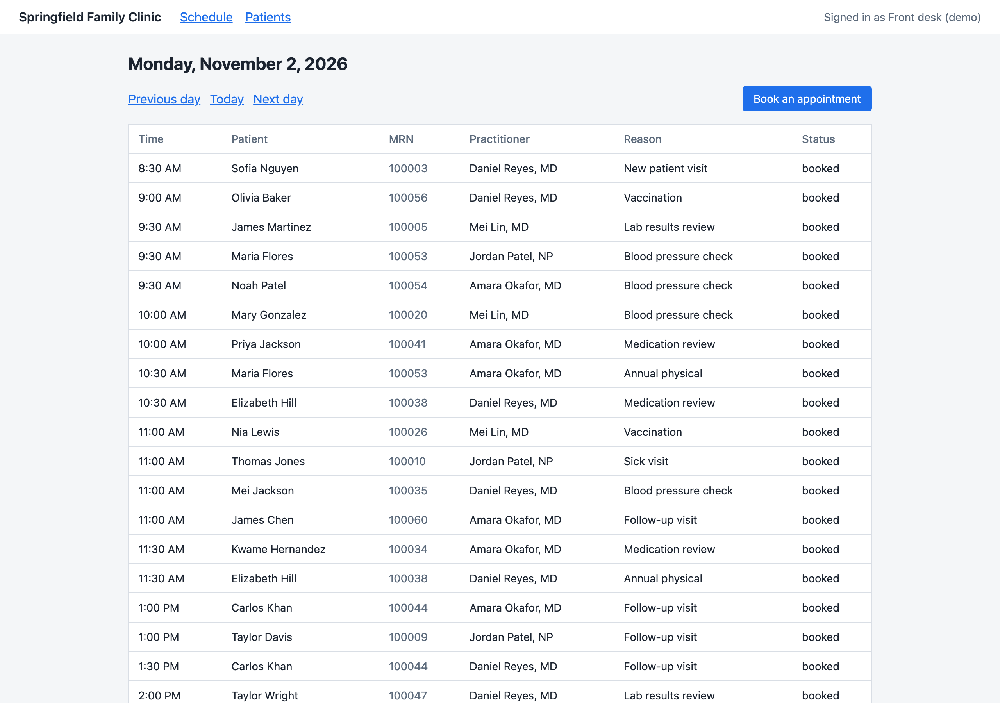

# Reference Apps

Runnable mock apps for regulated industries, built in the open. Each app is shaped like the systems
the industry really runs on, speaks the standards those systems use, and shows the rules the industry
is held to, such as HIPAA, in working code. All data is synthetic.

Use them to:

- test a product against something shaped like the real thing, without a vendor license or a sandbox
  account
- see what a rule like HIPAA asks of code, and test a compliance or security tool against an app that
  holds sensitive records
- learn the standards an industry runs on by reading and running working code
- build on: every app is Apache-2.0, and each one has a place to plug your own service in

Nothing here depends on or favors any vendor's product. The apps show what rules ask of code. Running
them doesn't make anyone compliant, and nothing here is legal advice.

Each app lives in its own folder with its own README, setup and tests, and runs on its own.

## Try it

You need [Docker](https://docs.docker.com/get-docker/) with Compose.

```bash
git clone https://github.com/Custosa-Inc/reference-apps.git
cd reference-apps/clinic
docker compose up --build
```

Then open http://localhost:3000.



To work on a single service without Docker, you need [Node.js 22](https://nodejs.org/) or later. Each
app's README explains how.

## Healthcare

| App | What it shows | Rules | Status |
| --- | --- | --- | --- |
| [clinic](clinic) | An outpatient clinic's front desk: patient search, appointment booking, an audit log of who saw which patient, a FHIR R4 API and a mock insurer that answers X12 eligibility checks | [HIPAA](clinic/HIPAA.md) | Early |

## Contributing

Pick an issue, close a gap in an app's compliance page, fix something that doesn't match how the real
systems work, or propose a new app. Read [CONTRIBUTING.md](CONTRIBUTING.md) to get started.

## License

[Apache-2.0](LICENSE).
