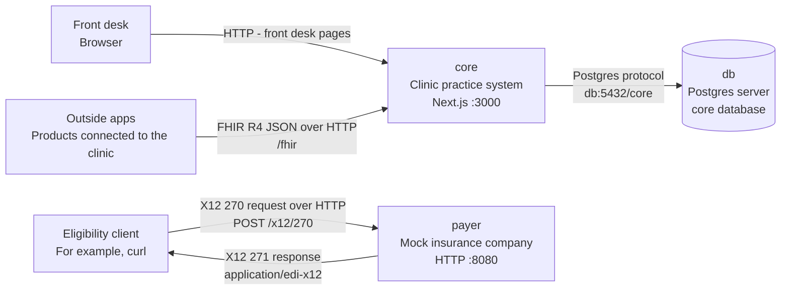

# Clinic architecture

The clinic app is a mock outpatient clinic, Springfield Family Clinic. It covers the system the front
desk uses to find patients and book appointments, plus the outside systems that system talks to.

## Services

The app is split where real healthcare splits: between systems run by different organizations or
vendors. Each service talks to the others through the standard the real systems use, so the standard
is the contract.

| Service | Stands in for | Talks through |
| --- | --- | --- |
| [core](services/core) | The clinic's own practice system | A FHIR R4 API for outside apps |
| [payer](services/payer) | An insurance company | X12 270/271 eligibility checks |

Fax, phone, lab and pharmacy services will join under `services/` as they are built. Each one will use
the standard its real counterpart uses.

Services that need persistent storage share one Postgres server, with a separate database for each
service. A service never reads another service's database.

## Service map



This shows the services in [compose.yaml](compose.yaml). The front desk and FHIR API are two
interfaces of the same `core` service. The `payer` service is currently stateless and does not use
Postgres. Checking eligibility from the front desk is not built yet, so there is no `core`-to-`payer`
connection in this map. Fax, phone, lab and pharmacy services are also not built yet.

## Inside core

`core` is one Next.js app with one database. Its code is split into modules:

```
src/
├── app/            pages and API routes
├── patients/       patient records
├── practitioners/  the doctors and nurse practitioners who see patients
├── schedule/       appointments
├── audit/          the log of who read or changed patient data
├── fhir/           turns records into FHIR resources for the API
├── session/        who is using the app (a fixed demo user for now)
├── db/             database connection, migrations and seed data
├── config.ts       clinic name and time zone
├── context.ts      the Context passed to every data function
└── time.ts         dates and times in the clinic's time zone
```

Four rules keep the modules apart:

1. A module owns its tables (`tables.ts`). Only its own files read or write them. Another module's
   `tables.ts` may point at them for a foreign key.
2. Modules call each other only through their `index.ts`.
3. Every function that reads or changes patient data takes a `Context` (the database plus who is
   acting) and records an audit event in the same transaction.
4. Only `session/`, `db/` and `instrumentation.ts` open the database. Everything else uses `ctx.db`.

`test/boundaries.test.ts` checks rules 1, 2 and 4 on every test run, so a change to one module doesn't
reach into the others.

Where FHIR R4 has a matching field, the tables use its names and codes. For example, appointment
statuses are FHIR's codes. That keeps the FHIR API a thin mapping in `fhir/`. Coded fields are Postgres
enum types, so the database refuses any value outside the list.

## Data

- All data is synthetic. `src/db/seed.ts` makes it.
- Times are stored in UTC and shown in the clinic's time zone (`CLINIC_TIMEZONE`).
- Before it handles requests, the app runs its migrations and seeds the database if it is empty. If
  that fails, it exits.
- Core uses Postgres when `DATABASE_URL` is set, and PGlite otherwise (decision 6).
- A practitioner can't be double-booked. The database enforces it with an exclusion constraint
  (`drizzle/0001_no_double_booking.sql`), which also holds when two bookings race.

## Plugging in

Outside products read clinic data through the FHIR API at `/fhir`. To run your own service next to the
clinic, see the README.
