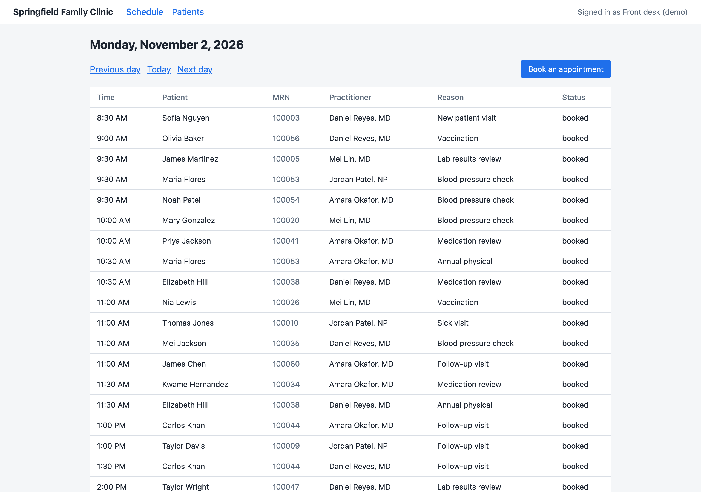

# Clinic

A mock outpatient clinic, Springfield Family Clinic, with synthetic patients. The front desk can
search for patients and book appointments. Every read and change of patient data goes into an audit
log. Outside apps read clinic data through a FHIR R4 API, and a mock insurer answers X12 270/271
eligibility checks.

The clinic is built around HIPAA. [HIPAA.md](HIPAA.md) lists each technical safeguard, what the
clinic does about it today and what's still missing.



## Run it

```bash
docker compose up --build
```

Then open:

| What | Where |
| --- | --- |
| The front desk screens | http://localhost:3000 |
| The FHIR API | http://localhost:3000/fhir/metadata |
| The mock payer | http://localhost:8080 |
| Postgres (user and password `clinic`) | localhost:5433 |

The ports listen on this computer only, since nothing has sign-in yet.

The first start creates the database and fills it with 60 patients, 4 practitioners and two weeks of
appointments starting today. Weekends are empty, like a real clinic. To start over with fresh data:

```bash
docker compose down --volumes
```

## See the audit log

There's no screen for it yet. With the app running:

```bash
docker compose exec db psql -U clinic -d core -c "SELECT recorded_at, actor_name, source, action, entity_type, patient_id FROM audit_events ORDER BY recorded_at DESC LIMIT 10"
```

## Work on core without Docker

```bash
cd services/core
npm install
npm run dev
```

Without `DATABASE_URL`, core runs Postgres inside Node with [PGlite](https://pglite.dev) and keeps its
data in `services/core/.data/`. Delete that folder to start over. Tests always use a fresh in-memory
database:

```bash
npm test
```

## How it's built

[ARCHITECTURE.md](ARCHITECTURE.md) explains the services and the rules that keep the code modular.
[DECISIONS.md](DECISIONS.md) records why. [HIPAA.md](HIPAA.md) tracks the HIPAA safeguards.

## FHIR API

FHIR R4, JSON only. Outside apps can read patients and appointments, find free slots, and book,
cancel or move appointments.

| Request | What it does |
| --- | --- |
| `GET /fhir/metadata` | What the server supports |
| `GET /fhir/Patient?name=smith` | Patients whose first or last name starts with each word |
| `GET /fhir/Patient/{id}` | One patient |
| `GET /fhir/Appointment?date=2026-11-02` | Appointments on a day in the clinic's time zone |
| `GET /fhir/Appointment?patient=Patient/{id}` | One patient's appointments |
| `GET /fhir/Appointment/{id}` | One appointment |
| `GET /fhir/Practitioner/{id}` | One practitioner |
| `GET /fhir/Schedule` | Each practitioner's schedule, which has the practitioner's ID |
| `GET /fhir/Slot?start=2026-11-02&status=free` | Free slots on a day. Add `schedule=Schedule/{id}` for one practitioner. |
| `GET /fhir/Slot/{id}` | One slot |
| `POST /fhir/Appointment` | Books an appointment |
| `PUT /fhir/Appointment/{id}` | Cancels or moves an appointment |

Searches return up to 50 results; use `_count` for up to 100. A search parameter not listed here
gets a 400 error rather than being ignored, so a typo never returns the wrong patients.

Links in responses use the host you called, such as `http://core:3000/fhir` from another container.
Behind a proxy, set `FHIR_BASE_URL` on core to the public address.

```bash
curl "http://localhost:3000/fhir/Patient?name=anderson"
```

### Book, cancel and move

The clinic sees patients on weekdays in half-hour slots from 8:30 to 5:00, with lunch from noon to
1:00. To book, send an Appointment with a Patient and either a free slot or a start, an end and a
Practitioner. The same rules apply as on the booking screen, and a booking the clinic refuses, such
as a time that's taken, gets a 422 that says why.

```bash
curl -X POST http://localhost:3000/fhir/Appointment -H "content-type: application/fhir+json" -d '{
  "resourceType": "Appointment",
  "status": "booked",
  "slot": [{ "reference": "Slot/SLOT_ID" }],
  "participant": [{ "actor": { "reference": "Patient/PATIENT_ID" } }]
}'
```

To cancel or move an appointment, read it, change it and `PUT` it back. To cancel, set `status` to
`cancelled`. To move, change `start` and `end`, and the Practitioner participant for someone else,
or remove all three and send a `slot`. Fields the clinic doesn't store, such as `comment`, get a 400
rather than being dropped. Every booking and change goes in the audit log.

## Mock payer

`POST /x12/270` takes an X12 270 eligibility request and returns a 271 response. For now every member
with an ID has active coverage. A request with no member ID gets an AAA rejection.

```bash
curl -X POST http://localhost:8080/x12/270 --data-binary @- <<'EOF'
ISA*00*          *00*          *ZZ*CLINIC         *ZZ*MOCKPLAN       *261101*0900*^*00501*000000101*0*T*:~GS*HS*CLINIC*MOCKPLAN*20261101*0900*101*X*005010X279A1~ST*270*0001*005010X279A1~BHT*0022*13*REQ0001*20261101*0900~HL*1**20*1~NM1*PR*2*MOCK HEALTH PLAN*****PI*MOCKPLAN~HL*2*1*21*1~NM1*1P*2*SPRINGFIELD FAMILY CLINIC*****XX*0000000000~HL*3*2*22*0~TRN*1*TRACE0001*9CLINIC~NM1*IL*1*DOE*JANE****MI*MEMBER123~DMG*D8*19800101~DTP*291*D8*20261101~EQ*30~SE*13*0001~GE*1*101~IEA*1*000000101~
EOF
```

The X12 handling is simplified and hasn't been checked against the official implementation guide.
Corrections are welcome.

## Plug in your own service

Create `compose.override.yaml` in this folder. Docker Compose loads it on top of `compose.yaml`, and
git ignores it. Your service can reach the FHIR API at `http://core:3000/fhir` and the payer at
`http://payer:8080`.

```yaml
services:
  my-service:
    image: example/my-service:latest
  # Replace the mock payer with your own:
  payer:
    image: example/my-payer:latest
    build: !reset null
```

## Not built yet

- Sign-in. Every screen acts as one demo user, and the FHIR API is open.
- Finding patients through the FHIR API by birth date, phone or record number
- Cancelling, rescheduling and checking in appointments on the screens
- New-patient intake
- Calling the payer from the front desk to check eligibility
- Fax, phone, lab and pharmacy services

These are open issues, and [HIPAA.md](HIPAA.md) lists the HIPAA safeguards still missing. Never put
real patient data in this app.
